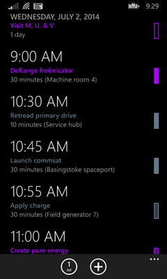

# AniList Metro

A high-performance, AMOLED-black anime and manga tracker for the web inspired by the classic Windows Phone 7 and Zune HD interface.

<div align="center">



### 🌐 **[👉 Open the Live Demo](https://pbk123461.github.io/Anilist-Metro/)**
*(No account needed — click **"Guest Mode"** on the start screen to explore instantly!)*

[](https://opensource.org/licenses/MIT)
[](https://graphql.anilist.co)
[](https://v4.metroui.org.ua/)
[](#credits--acknowledgements)
[](#how-it-works)

</div>

---

## ⚡ Quick Start

1. Open the **[Live Demo](https://pbk123461.github.io/Anilist-Metro/)**.
2. Click **"guest mode"** to immediately browse current seasonal releases, search the database, and check airing schedules.
3. *(Optional)* Click **"sign in with anilist"** to synchronize your personal anime and manga lists.

---

## ✨ Features

- **Horizontal Panoramic Shell**: Fluid 8-section panorama (`start`, `user`, `library`, `community`, `discover`, `airing`, `inbox`, `system`) with multi-layer parallax typography, smooth trackpad panning, and mouse drag navigation.
- **Tactile Web Audio Feedback**: Authentic Xbox 360 dashboard sound effects powered by the Web Audio API with real-time pitch randomization ($\pm 4\%$) and soft gain calibration so clicks never cause headphone fatigue.
- **One-Click Library Tracking**: Personal anime and manga collections load into an instant in-memory cache with a quick `+1` progress button that automatically marks a series as **Completed** and stamps today's date when you finish it.
- **Simulcast Airing Schedule**: Interactive calendar day strip and vertical countdown timeline streamer displaying exact release hours and minutes converted to your local timezone.
- **Multi-Facet Discovery**: Full-text debounced search across anime, manga, characters, and staff with filters for broadcast season, genres, country of origin, release format, and animation studios.
- **AMOLED-Optimized Customization**: Pure `#000000` dark mode, strict zero-radius corners, zero drop-shadows, dynamic wallpaper contrast overlays (65% dark / 85% light), and an interactive HSV Canvas Color Wheel.

---

## 💻 How to Run It Locally

AniList Metro is written in 100% Vanilla HTML5, CSS3, and JavaScript. There are **no build tools, no compilers, and zero `npm install` steps**.

### Requirements
- Any modern web browser (Chrome, Firefox, Safari, Edge).
- Python 3 (standard on macOS and Linux) or any static file server.

### Run in 3 Commands
```bash
# 1. Clone the repo
git clone https://github.com/pbk123461/Anilist-Metro.git
cd Anilist-Metro

# 2. Launch a local static server
python3 -m http.server 8000
```
Open [`http://localhost:8000`](http://localhost:8000) in your browser. Done!

---

## 🔬 How It Works & Technical Choices

### 1. Zero-Latency Audio via Web Audio API (`Sfx`)
Standard web audio implementations use HTML5 `<audio>` tags (`new Audio()`), which introduce a 50–150ms delay, cause memory leaks, and crackle when rapid clicks occur.  
`AniList Metro` implements a custom audio pipeline using the **Web Audio API (`AudioContext`)**:
- Sound assets (`.wav`) are fetched and decoded into uncompressed in-memory `AudioBuffer` objects at startup.
- Lightweight `AudioBufferSourceNode` instances are created on-demand and routed through a calibrated `GainNode` (4%–12% volume).
- Every trigger applies a randomized `playbackRate` between `0.96` and `1.04`, creating organic acoustic variety that avoids mechanical fatigue during rapid navigation.

### 2. Client-Side Polynomial Cache vs. AniList's 90 req/min Rate Limit
AniList enforces a strict rate limit of **90 requests per minute**. Navigating through discover grids, seasonal charts, and profile pages can easily exhaust this budget.  
To prevent HTTP 429 lockouts without a proxy backend:
- `CacheManager` generates deterministic 32-bit polynomial rolling hash keys from `{ query, variables }` stored in `localStorage`.
- API requests execute with a **stale-while-revalidate / cache-first strategy**: fresh data returns in `<1ms` from local storage.
- If an HTTP 429 rate limit is encountered, the client silently serves stale cached data and alerts the user with a non-intrusive Metro toast rather than crashing.
- Real-time rate limit headers (`X-RateLimit-Remaining`) are parsed and rendered directly into the top navigation telemetry bar.

### 3. AMOLED & Zero-Radius Layering over Metro UI v4
The application vendors Metro UI v4 for its solid 12-column grid and component semantics (`data-role="tile"`, `data-role="streamer"`), but completely overrides the default styling:
- Replaces default grey/white themes with pure AMOLED `#000000` to maximize OLED pixel shutoff.
- Enforces `border-radius: 0 !important` and `box-shadow: none !important` across all tiles, buttons, tabs, dialogs, and inputs.
- Custom wallpapers feature automated dual-pass contrast filters (65% black in dark mode, 85% white in light mode) guaranteeing WCAG AAA text legibility against any user-uploaded image.

### 4. Non-Blocking Drag Physics & Snap Suspension
Native CSS scroll snapping (`scroll-snap-type: x mandatory`) resists fluid mouse dragging.  
`PanoramaEngine` solves this by temporarily disabling snapping on `mousedown` (`scrollSnapType = 'none'`), applying a `1.5x` velocity multiplier during mouse movements, and restoring `x mandatory` snap on `mouseup`. Interactive children (buttons, links, inputs, tiles) are filtered via `e.target.closest()`, ensuring clicks register without triggering accidental drag captures.

---

## 📖 In-Depth Documentation

For detailed technical references, method signatures, and class designs, see the [`docs/`](docs/) directory:

- [**Audio Engine (`Sfx.md`)**](docs/Sfx.md) — Web Audio API buffer decoders, pitch modulation, and sound pack switching.
- [**Cache Manager (`CacheManager.md`)**](docs/CacheManager.md) — Polynomial hashing, TTL expiration, and rate-limit mitigation.
- [**API Network Client (`ApiClient.md`)**](docs/ApiClient.md) — GraphQL serialization, header telemetry, and backoff retries.
- [**Panorama Engine (`PanoramaEngine.md`)**](docs/PanoramaEngine.md) — Parallax math, drag gestures, and snap transitions.
- [**Theme Engine (`ThemeEngine.md`)**](docs/ThemeEngine.md) — AMOLED color tokens, Canvas HSV wheel, and wallpaper overlay math.
- [**Auth Manager (`AuthManager.md`)**](docs/AuthManager.md) — OAuth2 Implicit Grant, token sanitization, and Guest Mode isolation.
- [**Library Manager (`LibraryManager.md`)**](docs/LibraryManager.md) — In-memory collection caching, optimistic increments, and JSON exports.
- [**Media Editor (`MediaEditor.md`)**](docs/MediaEditor.md) — CRUD Charm panel, fuzzy dates, and auto-completion checks.
- [**Search Engine (`SearchEngine.md`)**](docs/SearchEngine.md) — Debounced querying, multi-facet filtering, and seasonal charts.
- [**Airing Schedule (`AiringScheduleManager.md`)**](docs/AiringScheduleManager.md) — Local timezone conversion and countdown streamer.
- [**Community Feed (`CommunityFeedManager.md`)**](docs/CommunityFeedManager.md) — Activity feeds, likes (`ToggleLikeV2`), and threaded replies.
- [**Notification Center (`NotificationManager.md`)**](docs/NotificationManager.md) — Unread counter polling and Start screen live tile badges.
- [**Detail Charm Panels (`DetailViewManager.md`)**](docs/DetailViewManager.md) — Right-sliding Charm panels for anime, manga, characters, and trailers.

---

## ❓ FAQ

**Q: Do I need an AniList account to use this?**  
A: No! Click **"guest mode"** on the start screen to explore seasonal charts, search anime, view airing countdowns, and read community discussions without signing in.

**Q: Why is all UI text lowercase?**  
A: Lowercase typography (`text-transform: lowercase`) is a signature design element of the original Windows Phone 7 and Zune HD Metro interface.

**Q: Why doesn't audio play immediately upon page load?**  
A: Modern browsers prohibit audio playback until the user interacts with the page. Clicking any button or tile resumes the `AudioContext`.

---

## 🙏 Credits & Acknowledgements

- **Brijesh Krishnan ([@pbk123461](https://github.com/pbk123461))** — Creator, Lead Developer & Designer (*developed with AI pair programming assistance*).
- **[AniList](https://anilist.co/)** for providing their excellent public [GraphQL v2 API](https://graphql.anilist.co).
- **[Metro UI CSS v4](https://v4.metroui.org.ua/)** by Serhii Pimenov for the foundational CSS grid and tile component models.
- **Microsoft Corporation** for creating the Windows Phone 7, Zune HD, and Xbox 360 Metro design language.
- **[FontAwesome](https://fontawesome.com/)** for iconography.
- Sound assets adapted from the Xbox 360 Dashboard sound pack by *fantomnotphantom*.

---

## 📄 License

This project is licensed under the **MIT License** — see the [LICENSE](LICENSE) file for details.
